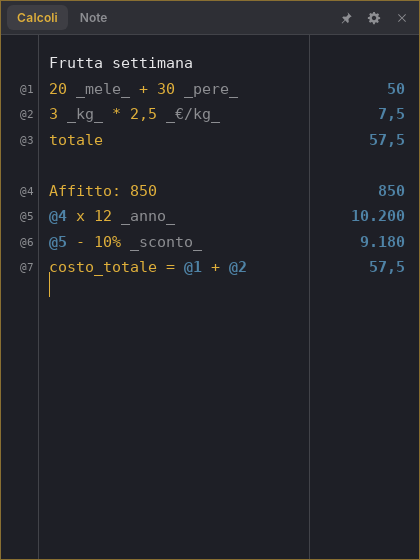
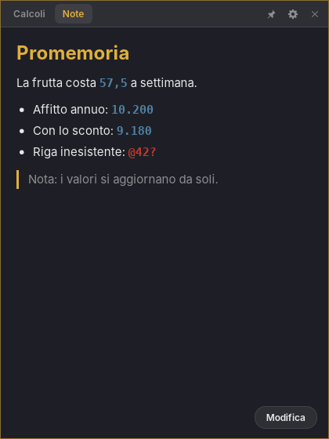
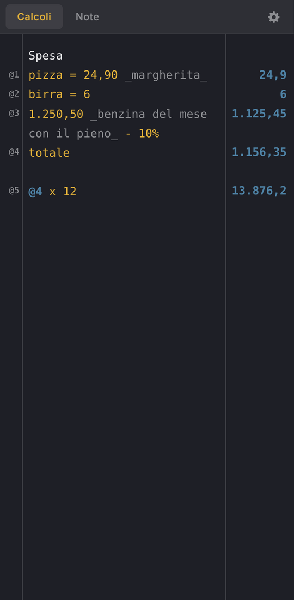
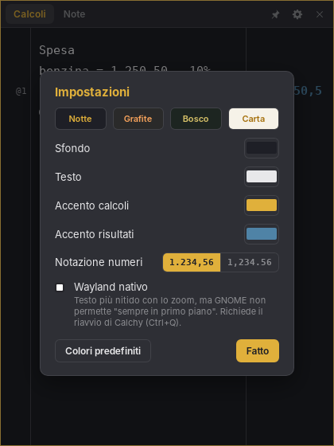
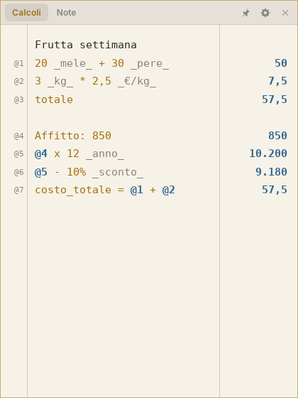

<p align="center">
  
</p>

<h1 align="center">Calchy</h1>

<p align="center">
  Un blocco note infinito che fa i calcoli, per Linux (GNOME) e Android.<br>
  Ispirato a <a href="https://github.com/nikolaeu/numi">Numi</a>, pensato per chi scrive i numeri all'italiana.
</p>

<p align="center">
  
  &nbsp;
  
</p>

---

## Cos'è

Calchy è una piccola finestra sempre a portata di tastiera: la richiami con una scorciatoia, scrivi, la nascondi.
Funziona come un post-it infinito. Puoi scrivere testo libero e calcoli mescolati tra loro: Calchy riconosce da solo le righe con un'operazione, le colora e mostra il risultato a destra.
Tutto viene salvato automaticamente, ogni volta che premi un tasto.

- **Numeri all'italiana**: virgola per i decimali, punto per le migliaia (`1.250,50`). Chi preferisce la notazione anglosassone (`1,250.50`) può attivarla nelle impostazioni.
- **Richiami tra righe**: ogni calcolo ha un numero (`@1`, `@2`…) che puoi riusare più sotto; se cambi la riga di partenza, tutto si ricalcola.
- **Note dentro i calcoli**: `20 _mele_ + 30 _pere_` fa 50 e ti ricorda cosa stavi contando.
- **Tab Note** in markdown, che può mostrare i risultati dei calcoli.
- **Percentuali, unità di misura, variabili, totali** e funzioni matematiche.
- **Sempre in primo piano**, temi di colore, scorciatoia globale di GNOME.

---

## Installazione

Ogni release contiene due file:

| File | Per |
|---|---|
| `Calchy-x.y.z-1.x86_64.rpm` | Fedora (testata su Fedora 44 con GNOME 50) |
| `Calchy-x.y.z-android.apk` | telefoni Android 8 o successivi (64 bit) |

### Fedora

1. Scarica l'ultimo file `Calchy-x.y.z-1.x86_64.rpm` dalla pagina [**Releases**](../../releases/latest).
2. Apri il terminale nella cartella dove l'hai scaricato e installalo:

   ```bash
   sudo dnf install ./Calchy-*.x86_64.rpm
   ```

3. Attiva la scorciatoia da tastiera (una volta sola):

   ```bash
   calchy --setup-gnome
   ```

Da questo momento **Super + Alt + C** apre e nasconde Calchy da qualsiasi punto, e l'app parte in background a ogni accesso, così compare all'istante.

Preferisci un'altra combinazione? Passala al comando, ad esempio:

```bash
calchy --setup-gnome "<Ctrl><Alt>k"
```

Puoi cambiarla anche in seguito da *Impostazioni → Tastiera → Scorciatoie da tastiera → Scorciatoie personalizzate*.

### Aggiornare

Scarica il nuovo RPM e installalo con lo stesso comando: i tuoi dati restano dove sono.
Poi chiudi la versione in esecuzione con **Ctrl + Q** e riaprila.

### Disinstallare

```bash
sudo dnf remove calchy
rm ~/.config/autostart/calchy.desktop
```

I tuoi testi restano in `~/.local/share/io.github.calchy/`: cancella quella cartella solo se vuoi eliminarli davvero.

---

### Android



1. Dal telefono apri la pagina [**Releases**](../../releases/latest) e scarica `Calchy-x.y.z-android.apk`.
2. Apri il file scaricato (dalla notifica o dall'app *File*).
3. La prima volta Android chiede di **consentire l'installazione da questa fonte**: tocca *Impostazioni*, attiva l'interruttore per il browser e torna indietro.
4. Tocca **Installa**. Se compare un avviso di Play Protect, tocca *Installa comunque*: l'app non viene dal Play Store, quindi Google non la conosce.

Per aggiornare basta installare il nuovo APK sopra il vecchio: i dati restano.

Su Android non ci sono il pulsante "sempre in primo piano", la ✕ e le scorciatoie da tastiera; tutto il resto funziona come su Linux. Per cambiare tab basta trascinare il dito verso sinistra (Note) o verso destra (Calcoli). I dati del telefono sono separati da quelli del computer.

<br clear="right">

---

## Come si usa

### Tab Calcoli

Scrivi una riga alla volta. Se Calchy la riconosce come calcolo, la colora e mostra il risultato nella colonna di destra; altrimenti la lascia come testo normale.

| Scrivi | Ottieni | Note |
|---|---|---|
| `1.250,50 + 749,50` | `2.000` | virgola = decimali, punto = migliaia (in notazione anglosassone: `1,250.50`) |
| `pizza = 24,90` | `24,9` | crea una variabile… |
| `pizza * 3` | `74,7` | …che puoi riusare sotto |
| `120 - 10%` | `108` | sconti e ricarichi |
| `100 + 22%` | `122` | IVA inclusa |
| `10% di 200` | `20` | percentuale di un valore |
| `3 x 4` · `10 per 3` · `100 diviso 8` | `12` · `30` · `12,5` | operazioni anche a parole |
| `20 inch in cm` | `50,8 cm` | conversioni (funziona anche `to`) |
| `sqrt(144)` · `round(7,456; 2)` | `12` · `7,46` | funzioni: argomenti separati da `;` |
| `Affitto: 850` | `850` | etichetta: si calcola solo ciò che segue i `:` |
| `20 _mele_ + 30 _pere_` | `50` | il testo tra due `_` viene ignorato |
| `# promemoria` | — | commento, mai calcolato |

#### Richiami con @

Ogni riga di calcolo riceve un numero progressivo, visibile nel margine sinistro: `@1`, `@2`, `@3`…
Scrivi `@N` in un'altra riga per riusarne il risultato:

```
     Frutta settimana
@1   20 _mele_ + 30 _pere_            50
@2   3 _kg_ * 2,5 _€/kg_             7,5
@3   totale                         57,5

@4   Affitto: 850                    850
@5   @4 x 12 _anno_               10.200
@6   @5 - 10% _sconto_             9.180
```

- Se modifichi la riga `@4`, le righe `@5` e `@6` si aggiornano da sole.
- **Clic su un `@N` nel margine** e il richiamo viene inserito dove si trova il cursore.
- I numeri seguono l'ordine delle righe: se aggiungi un calcolo *sopra* una riga già richiamata, i numeri successivi scorrono di uno.

#### Parole speciali

| Parola | Cosa fa |
|---|---|
| `totale` (o `somma`) | somma i risultati del blocco sopra; un blocco finisce con una riga vuota |
| `media` | media dei risultati del blocco |
| `prev` (o `prec`) | il risultato della riga di calcolo precedente |

**Clic su un risultato** a destra per copiarlo negli appunti.

### Tab Note

Un foglio di testo libero in **markdown**, per appunti più lunghi e ordinati:

```markdown
# Promemoria
La frutta costa **@3** a settimana.

- Affitto annuo: @5
- Con lo sconto: @6
```

Scrivendo `@N` compare il risultato della riga corrispondente del tab Calcoli, sempre aggiornato. Se la riga non esiste, il richiamo appare in rosso.

- **Clic sul testo** (o **Ctrl + E**) per modificare.
- **Esc**, o un clic fuori, per tornare all'anteprima formattata.
- Supporta titoli (`#`), **grassetto**, *corsivo*, elenchi, citazioni (`>`), tabelle e `codice`.

### Barra superiore

| Pulsante | Funzione |
|---|---|
| **Calcoli / Note** | cambia tab |
| 📌 | sempre in primo piano sì/no |
| ⚙ | impostazioni |
| ✕ | nasconde la finestra (Calchy resta pronta in background) |

Trascina la barra per spostare la finestra; trascina i bordi per ridimensionarla.

### Impostazioni



Dall'ingranaggio puoi:

- scegliere un **tema pronto**: Notte, Grafite, Bosco, Carta (chiaro);
- cambiare singolarmente **sfondo**, **testo**, **accento dei calcoli** e **accento dei risultati**;
- scegliere la **notazione dei numeri**: europea `1.234,56` o anglosassone `1,234.56`. Al cambio, i numeri già scritti nelle righe di calcolo vengono convertiti automaticamente;
- attivare la modalità **Wayland nativo** (vedi sotto).

Le modifiche si vedono subito e vengono salvate da sole.

<br clear="right">

<p align="center"></p>

---

## Scorciatoie da tastiera

| Tasti | Azione |
|---|---|
| **Super + Alt + C** | mostra / nasconde Calchy (dopo `calchy --setup-gnome`) |
| **Esc** | nasconde la finestra |
| **Ctrl + 1** / **Ctrl + 2** | tab Calcoli / tab Note |
| **Ctrl + Tab** | passa da un tab all'altro |
| **Ctrl + E** | nel tab Note: modifica / anteprima |
| **Ctrl + T** | sempre in primo piano sì/no |
| **Ctrl + +** / **Ctrl + −** / **Ctrl + 0** | ingrandisce / riduce / ripristina il testo |
| **Ctrl + Q** | chiude davvero Calchy |

---

## Sempre in primo piano e Wayland

Su GNOME con Wayland le applicazioni non possono mettersi da sole sopra le altre finestre: è una scelta di sicurezza di GNOME.
Per questo Calchy, salvo diversa scelta, gira tramite **XWayland**, il livello di compatibilità di GNOME: in questa modalità il pulsante 📌 funziona.

Se usi lo zoom frazionario dello schermo (ad esempio 125%) il testo potrebbe risultare un po' meno nitido. In quel caso attiva **Wayland nativo** nelle impostazioni e riavvia Calchy (Ctrl + Q, poi riaprila). Il pulsante 📌 verrà disattivato, ma puoi ottenere lo stesso effetto con **Alt + Spazio → Sempre in primo piano**.

---

## Dove sono i miei dati

Tutto è salvato in testo semplice in `~/.local/share/io.github.calchy/`:

| File | Contenuto |
|---|---|
| `note.txt` | il tab Calcoli |
| `notes.md` | il tab Note |
| `settings.json` | colori e preferenze |

Puoi copiarli per fare un backup o aprirli con qualsiasi editor.

---

## Problemi comuni

**La scorciatoia non apre niente.**
Controlla che Calchy sia installata (`which calchy` deve rispondere `/usr/bin/calchy`) e rilancia `calchy --setup-gnome`. Verifica anche che la combinazione non sia già usata da GNOME o da un'altra app.

**Premendo la scorciatoia compare la notifica "Calchy è pronto" invece della finestra.**
È la protezione di GNOME contro le finestre che rubano il focus. Clicca la notifica, oppure assicurati che Wayland nativo sia disattivato nelle impostazioni.

**Il pulsante 📌 non tiene la finestra in primo piano.**
Probabilmente è attiva la modalità Wayland nativo: disattivala dalle impostazioni e riavvia Calchy.

**Una riga non viene calcolata.**
Calchy la considera testo se contiene parole che non conosce. Usa un'etichetta (`Spesa: 24 + 10`) oppure racchiudi le parole tra `_` (`24 _pane_ + 10 _latte_`).

---

## Per sviluppatori

Calchy è costruita con [Tauri 2](https://tauri.app) (Rust + WebKitGTK) e [math.js](https://mathjs.org); le note usano [marked](https://marked.js.org).

```bash
# Dipendenze su Fedora
sudo dnf install -y git nodejs npm rust cargo gcc \
  webkit2gtk4.1-devel gtk3-devel librsvg2-devel openssl-devel

git clone https://github.com/albertosusco/Calchy.git
cd Calchy
npm install

npm run tauri dev      # avvia l'app in modalità sviluppo
npm test               # verifica il motore di calcolo
npm run tauri build    # crea l'RPM in src-tauri/target/release/bundle/rpm/
```

L'APK per Android viene compilato da GitHub Actions (servono Android SDK, NDK e Java 17).
La firma usa la chiave salvata nei Secrets del repository (`ANDROID_KEYSTORE`, in base64, e `ANDROID_KEYSTORE_PASSWORD`); senza, l'APK viene firmato con una chiave temporanea e gli aggiornamenti richiedono di disinstallare la versione precedente.

Struttura del progetto:

```
src/engine.js          motore di calcolo (numeri italiani, @N, note, percentuali)
src/main.js            interfaccia: tab, salvataggio, impostazioni
src/styles.css         aspetto e temi
src-tauri/src/lib.rs   finestra, salvataggio su file, scorciatoia GNOME
tests/                 test del motore
```

### Pubblicare una nuova versione

1. Aumenta il numero di versione in `src-tauri/tauri.conf.json` (ad esempio da `1.3.0` a `1.3.1`).
2. Carica la modifica su `main`.

GitHub Actions si accorge che la versione non è ancora pubblicata, compila l'RPM su Fedora e l'APK per Android e crea da solo la release `v1.3.1`.
Le modifiche che non cambiano il numero di versione (per esempio al README) non avviano nessuna compilazione.
Funziona anche il metodo classico: `git tag v1.3.1 && git push origin v1.3.1`.

Dalla scheda **Actions → Release → Run workflow** puoi lanciare una compilazione di prova in qualsiasi momento: produce i file (scaricabili dalla pagina dell'esecuzione) senza pubblicare nulla.

---

## Licenza

[MIT](LICENSE). Calchy è un progetto indipendente, ispirato a [Numi](https://github.com/nikolaeu/numi) ma senza codice in comune.
